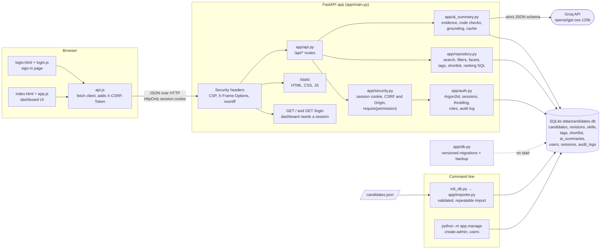

# GCCX Candidate Triage Tool

Take-home for the GCCX Global AI Full-Stack Engineer Intern role (Task 1: Candidate Triage Tool).

A recruiter dashboard (plain HTML, CSS and JavaScript) on a FastAPI + SQLite API: candidate
search and filtering, recruiter tags and shortlist, skill-overlap ranking, evidence-grounded
AI fit summaries, and sign-in with three roles (admin, hiring manager, recruiter).

## Quick start

```bash
python init_db.py                                             # import candidates.json into data/candidates.db
python -m app.manage create-admin --email you@example.com     # prompts for a password (12+ characters)
uvicorn app.main:app --reload --reload-dir app --reload-dir static   # then open http://127.0.0.1:8000
```

(Set up the virtual environment first; see [Setup](#setup).) `--reload-dir` keeps the auto-reloader
from polling every file in `.venv`, which otherwise uses a full CPU core continuously.

## Architecture



How a request flows:

1. The browser calls `/api/*` through `api.js`, sending the session cookie, plus the CSRF token on
   writes.
2. Every protected route depends on `require(permission)` in `app/security.py`. That checks the
   session (401 if missing or expired), the CSRF token and Origin on writes (403), and the role's
   permission (403), before the route runs.
3. Routes call `app/repository.py` for candidate data and `app/ai_summary.py` for summaries. The
   AI module calls Groq only when nothing is cached for this candidate version and these required
   skills.
4. Recruiter changes are written to the audit log in the same transaction as the change.

Candidate data enters only through the importer. Accounts are created only through `app.manage`
or an admin in the dashboard. The server, the importer and `app.manage` all apply pending schema
migrations before they touch the database.

## Setup

Requires Python 3.12.

```powershell
# Windows (PowerShell)
py -3.12 -m venv .venv
.\.venv\Scripts\Activate.ps1
pip install -r requirements.txt
```

```bash
# macOS / Linux
python3.12 -m venv .venv
source .venv/bin/activate
pip install -r requirements.txt
```

For AI summaries, copy `.env.example` to `.env` and set `GROQ_API_KEY`
(get one at https://console.groq.com). `.env` is gitignored. Everything else works without a key.

## Importing the candidates

```bash
python init_db.py --dry-run   # show what would change, write nothing
python init_db.py             # create or update data/candidates.db
```

Options: `--json PATH` (default `candidates.json`), `--db PATH` (default `data/candidates.db`).

Exit codes: `0` success · `1` imported, but some records were invalid and skipped ·
`2` could not run (missing or malformed JSON, or a database with the old schema).

The import is safe to run repeatedly:

| Record in the file | What happens |
|---|---|
| New id | Inserted |
| Same content as last time | Nothing |
| Changed content | Candidate updated; the previous version is kept in `candidate_revisions`; the report lists the changed fields |
| Id no longer in the file | Kept, not deleted; listed as missing |
| Invalid (wrong types, missing required field, bad date, duplicate id) | Skipped with a reason |

Recruiter tags and shortlist status live in their own tables, which the importer never writes to.
Missing optional values (`years_experience`, `applied_date`) are stored as `NULL`, never as made-up defaults.

## The dashboard

Open http://127.0.0.1:8000 after starting the server. It has no build step and loads nothing
from the internet.

- **Candidates:** search (name, role, notes, skills), filter by role, source, tag and shortlist
  status, sort, and page through the table. Filters are kept in the URL, so a view can be
  bookmarked or reloaded.
- **Rank by skills:** add required skills (Enter or comma; suggestions come from the data),
  optionally filter by role or source. Shows each candidate's score, coverage, and matched and
  missing skills. Skills no candidate has are called out.
- **Detail panel** (select a name): notes, skills, tags (add and remove), shortlist toggle, and the
  AI fit summary. Opened from a ranking, the summary is judged against the ranked skills too.
  The summary shows fit, strengths and concerns with their quoted evidence, contradictions
  (code-detected ones are marked "Data check"), skill gaps, open questions, and how many AI
  claims were dropped for lacking evidence. It is only generated when you click the button,
  because each new summary is a paid AI call.
- Works from phone width up (the detail panel becomes an overlay below 1180px), in light and dark
  mode. Every API error is shown as a readable message.

Files: [static/index.html](static/index.html), [static/css/styles.css](static/css/styles.css),
[static/js/app.js](static/js/app.js) (UI), [static/js/api.js](static/js/api.js) (one function per
endpoint), [static/js/utils.js](static/js/utils.js) (pure helpers). FastAPI serves the page at `/`
and the files under `/static`, with `Cache-Control: no-cache` so browsers pick up changes.

## The API

Interactive API docs: http://127.0.0.1:8000/docs

Every endpoint except `GET /api/health` and `POST /api/auth/login` needs a signed-in user (see
[Accounts, roles and security](#accounts-roles-and-security)).

| Endpoint | Who | Returns |
|---|---|---|
| `POST /api/auth/login` `{email, password}` | anyone | `{user, permissions, csrf_token, session_expires_at}` and the session cookie; 401 wrong credentials, 403 deactivated, 429 throttled |
| `POST /api/auth/logout` | signed in | 204; ends the session |
| `GET /api/auth/me` | signed in | Same shape as login, including a current CSRF token |
| `POST /api/auth/password` `{current_password, new_password}` | signed in | 204; signs out your other sessions |
| `GET /api/activity` | admin, hiring manager | Recent tags, shortlist changes and generated summaries |
| `GET /api/admin/users`, `POST /api/admin/users` | admin | List and create accounts (never includes password hashes) |
| `PATCH /api/admin/users/{id}` `{role?, is_active?}` | admin | 409 if it would leave no active admin; deactivating signs the user out |
| `POST /api/admin/users/{id}/password` `{password}` | admin | 204; signs the user out everywhere |
| `GET /api/admin/audit-logs?action=&limit=&offset=` | admin | The full audit log, newest first |
| `GET /api/candidates/{id}/summary?requirements=` | all roles | A cached AI summary, or 404 if none yet; never calls the AI |

| Endpoint | Returns |
|---|---|
| `GET /api/health` | Public. `{status, db, candidates, ai_configured}`; 200 when the database is readable, 503 when not. `ai_configured` only says whether `GROQ_API_KEY` is set; the key is never returned. |
| `GET /api/candidates` | `{items, total, limit, offset}` (items have no notes) |
| `GET /api/candidates/{id}` | One candidate including `notes`; 404 if unknown |
| `GET /api/facets` | `{total, shortlisted, roles, sources, skills, tags}`, each a list of `{value, count}` |

Query parameters for `GET /api/candidates` (anything else gives 422):

| Parameter | Meaning |
|---|---|
| `q` | Words to find (≤100 chars). Each word must appear in the name, role, notes or a skill; case-insensitive; `%` and `_` are matched literally |
| `role`, `source` | Exact match; use the values from `/api/facets` |
| `tag` | Recruiter tag, case-insensitive |
| `shortlisted` | `true` or `false` |
| `sort` | `-applied_date` (default), `applied_date`, `name`, `-name`, `-years_experience`, `years_experience`. Unknown values sort last; ties go by `id` |
| `limit`, `offset` | 1–200 (default 50), and ≥0 |

Blank values (`?role=`) mean no filter. Unstated `years_experience` and `applied_date` are `null`.

```bash
curl "http://127.0.0.1:8000/api/candidates?role=ML%20Engineer&source=AngelList&sort=-years_experience"
curl "http://127.0.0.1:8000/api/candidates?q=kubernetes&limit=10&offset=10"
curl "http://127.0.0.1:8000/api/candidates/cand_009"
curl "http://127.0.0.1:8000/api/facets"
```

### Skill ranking

`GET /api/rank?skills=Python&skills=FastAPI&skills=Django` ranks candidates by how many of
the required skills they have. Repeat `skills` once per skill (1–20, each ≤60 characters;
a comma-separated value is treated as one skill name).

| Parameter | Meaning |
|---|---|
| `skills` | Required skills; case and spacing ignored, duplicates counted once |
| `role`, `source` | Optional exact filters, as in `/api/candidates` |
| `limit`, `offset` | 1–200 (default 20), and ≥0 |

Response: `{query_skills, unknown_skills, items, total, limit, offset}`. Each item is
`{candidate, score, coverage, matched_skills, missing_skills}`, where `score` is the number of
required skills matched and `coverage` = score ÷ recognised required skills. Order: score,
then years of experience (unknown last), then id. Candidates with no required skill are left
out. Skills no candidate has are listed in `unknown_skills`.

Algorithm, complexity and 100k-candidate benchmark: [docs/RANKING.md](docs/RANKING.md).
To rerun the benchmark (takes ~1 minute, including importing 100k synthetic candidates into
a temporary database):

```bash
python -m benchmarks.ranking_benchmark            # --count, --runs, --db PATH to reuse a database
```

```bash
curl "http://127.0.0.1:8000/api/rank?skills=Python&skills=FastAPI&skills=Django"
curl "http://127.0.0.1:8000/api/rank?skills=Kubernetes&skills=Docker&role=DevOps%20Engineer&limit=5"
```

### AI fit summaries

`POST /api/candidates/{id}/summary` with an optional body
`{"requirements": ["Python", "FastAPI"], "refresh": false}` returns an evidence-grounded fit
summary from `openai/gpt-oss-120b` on Groq (called through the `openai` SDK).

| Field | Meaning |
|---|---|
| `summary`, `fit` | Up to two sentences; fit is `strong`, `moderate`, `weak` or `insufficient_evidence` |
| `strengths`, `concerns` | `{claim, evidence}`; `evidence` is quoted word for word from the candidate's record |
| `contradictions` | `{claim, evidence, source}`; `source` is `data_check` (found by code) or `model` |
| `skill_gaps` | `required_missing` and `required_in_notes_only` (computed by code from `requirements`), `role_gaps` (the model's judgement) |
| `missing_information` | What the recruiter should still find out |
| `grounding` | How many claims the model made, and which were dropped because their evidence wasn't in the record |
| `cached`, `model`, `prompt_version`, `generated_at` | Provenance |

How it stays grounded:
- The evidence is the candidate's stored record exactly as imported. The model gets it as data,
  with instructions to ignore any instructions inside it, and must answer in a strict JSON schema.
- Code checks run before the model and are always included: skills the notes mention but the
  skills list lacks (12 of the 48 candidates), years in the notes against `years_experience`,
  and which `requirements` the candidate has.
- Every claim's quoted evidence must be found in the record (ignoring case and spacing),
  otherwise the claim is dropped and listed in `grounding.dropped`.
- The prompt tells the model not to guess the candidate's gender from their name. That is an
  instruction, not a code check.

Caching: one entry per candidate version, requirement set (order and case don't matter),
prompt version and model, in the `ai_summaries` table. Re-importing a changed record or changing
the prompt produces a fresh summary. `"refresh": true` forces a new call. Cached summaries are
served even if the key is later removed. Failures are never cached.

| Status | When |
|---|---|
| 404 | Unknown candidate (the model isn't called) |
| 422 | Invalid body: more than 20 requirements, a requirement over 60 characters, non-boolean `refresh`, unknown fields |
| 502 | Key rejected, AI service unreachable or erroring, or an unusable response |
| 503 | No key configured (and nothing cached), or the AI service is rate-limiting |
| 504 | The AI service timed out (`GROQ_TIMEOUT_SECONDS`, default 30; the SDK retries twice) |

Error messages never include the key or the provider's raw error text.

```bash
curl -X POST "http://127.0.0.1:8000/api/candidates/cand_009/summary"
curl -X POST "http://127.0.0.1:8000/api/candidates/cand_002/summary" -H "Content-Type: application/json" -d "{\"requirements\": [\"Python\", \"FastAPI\", \"React\"]}"
```

### Recruiter actions

| Endpoint | Body | Result |
|---|---|---|
| `POST /api/candidates/{id}/tags` | `{"tag": "strong backend"}` | `{id, tags}`; 201 if added, 200 if the candidate already had it |
| `DELETE /api/candidates/{id}/tags/{tag}` | — | `{id, tags}`; 200 even if the tag wasn't there |
| `PUT /api/candidates/{id}/shortlist` | `{"shortlisted": true}` or `false` | `{id, shortlisted, shortlisted_at}`; repeating keeps the original time |

- Tags are lowercased with spaces collapsed (`" Strong  Backend"` → `"strong backend"`), so differently
  written versions count as the same tag. Allowed: 1–40 letters, digits, spaces, `-`, `_`.
- `shortlisted` must be a JSON `true` or `false`. Unknown body fields are rejected.
- Unknown candidate → 404. Invalid body or tag → 422. Body checks run first, so an invalid body
  for an unknown candidate gives 422.
- These write only to `candidate_tags` and `shortlist`, which the importer never touches, so tags and
  shortlist status survive re-imports.

```bash
curl -X POST "http://127.0.0.1:8000/api/candidates/cand_009/tags" -H "Content-Type: application/json" -d "{\"tag\": \"strong backend\"}"
curl -X DELETE "http://127.0.0.1:8000/api/candidates/cand_009/tags/strong%20backend"
curl -X PUT "http://127.0.0.1:8000/api/candidates/cand_009/shortlist" -H "Content-Type: application/json" -d "{\"shortlisted\": true}"
```

- On startup the app creates any missing tables. It does not import candidates; run
  `python init_db.py` for that.
- Set `GCCX_DB_PATH` to use a different database file.

## Accounts, roles and security

Everything except `GET /api/health` and the sign-in page requires signing in. There is no
self-registration and no default account.

### Creating the first administrator

Run this on the server, as someone with access to the database file:

```bash
python -m app.manage create-admin --email you@example.com
```

It asks for the password twice without echoing it (12–128 characters). For scripts, pipe it in
with `--password-stdin`. Passwords are never accepted as command-line arguments, because those
end up in shell history and process lists. Until an administrator exists, the server logs a
warning on every start.

The same tool manages accounts from the server, which is useful if the last administrator is
locked out:

```bash
python -m app.manage create-user --email r@example.com --role recruiter   # or hiring_manager / admin
python -m app.manage list-users
python -m app.manage set-role --email r@example.com --role hiring_manager
python -m app.manage deactivate --email r@example.com                     # also signs them out
python -m app.manage activate --email r@example.com
python -m app.manage reset-password --email r@example.com                 # also signs them out
```

After that, administrators manage accounts in the dashboard's **Users** tab.

### Demo accounts (local only)

```bash
python -m app.manage create-demo
```

This creates three accounts, all with the password `DEMO@123`: `admin@gmail.com`,
`recruiter@gmail.com` and `manager@gmail.com` (emails are case-insensitive). The demo password is
shorter than the 12-character policy on purpose; only these accounts skip it. Running the command
again resets them. Set `GCCX_DEMO_LOGIN=1` to list them on the sign-in page, where you
can click one to fill in the form. These passwords are in the source code, so don't create these
accounts on a server other people can reach.

### Roles

| Role | Can |
|---|---|
| Recruiter | Search and view candidates, rank by skills, add and remove tags, shortlist, generate AI summaries |
| Hiring manager | Search and view candidates, rank by skills, read AI summaries a recruiter generated (not generate new ones, which are paid calls), see recruitment activity |
| Admin | Create users, change roles, activate and deactivate accounts, reset passwords, read the full audit log, view candidates, rankings and cached summaries |

Admins have read-only access to candidates. Tagging, shortlisting and generating summaries are
recruiter work, so an admin account can't change candidate data. The whole permission table is
`PERMISSIONS` in [app/auth.py](app/auth.py), and every API route names the permission it needs.
The dashboard hides controls a role can't use, but the server checks every request regardless
(401 when not signed in, 403 when the role doesn't allow it).

### How it's protected

- **Passwords:** Argon2id via `argon2-cffi` (64 MiB, 3 passes). Stored only as hashes, and
  upgraded automatically on sign-in if the parameters change.
- **Sessions:** a random 256-bit token in an `HttpOnly`, `SameSite=Lax` cookie. The database
  stores only its SHA-256. Sessions end after 2 hours idle or 12 hours total, and on sign-out,
  deactivation, password reset or password change (other devices).
- **CSRF:** every `POST`/`PUT`/`PATCH`/`DELETE` needs the `X-CSRF-Token` header, an HMAC of the
  session token returned by `/api/auth/me`. Requests carrying another site's `Origin` are refused.
- **Brute force:** after 5 failed sign-ins for an email (or 30 from one IP) within 15 minutes,
  sign-in pauses and the API returns 429 with `Retry-After`. Unknown emails take as long to reject
  as wrong passwords, and both get the same message.
- **Headers:** a Content Security Policy (scripts and styles from this site only, no framing),
  `X-Frame-Options: DENY`, `nosniff`, and a same-origin referrer policy.
- **Audit log:** sign-ins (successful, failed, throttled), sign-outs, account changes, tags,
  shortlist changes and generated summaries, with who, when and from which IP. The table is
  append-only, enforced by database triggers. Passwords and tokens are never logged.

### Production settings

Set these in `.env` (see [.env.example](.env.example)):

| Variable | Default | Production |
|---|---|---|
| `GCCX_SECRET_KEY` | random per server start | Set it: 32+ characters, e.g. `python -c "import secrets; print(secrets.token_urlsafe(48))"` |
| `GCCX_COOKIE_SECURE` | `auto` (Secure when the request is HTTPS) | `always`, and serve over HTTPS |
| `GCCX_SESSION_IDLE_MINUTES`, `GCCX_SESSION_MAX_HOURS` | 120, 12 | As your policy requires |
| `GCCX_LOGIN_MAX_FAILURES`, `GCCX_LOGIN_MAX_FAILURES_PER_IP`, `GCCX_LOGIN_WINDOW_MINUTES` | 5, 30, 15 | As your policy requires |

Behind a reverse proxy, start uvicorn with `--proxy-headers --forwarded-allow-ips=<proxy IP>`.
Otherwise every request looks like it comes from the proxy, which skews the per-IP limit and
`auto` cookie security.

### Trying each role locally

```bash
python -m app.manage create-admin --email admin@example.com
python -m app.manage create-user --email recruiter@example.com --role recruiter
python -m app.manage create-user --email manager@example.com --role hiring_manager
```

Sign in as each one, in separate browsers or one after another using **Sign out**:

| Role | What you should see |
|---|---|
| Recruiter | Candidates and Rank tabs; tag editor, shortlist button, Generate summary |
| Hiring manager | Also an Activity tab; tags and shortlist read-only; Load summary (cached only) |
| Admin | All four tabs including Users; the Activity tab shows the full audit log with IPs |

To check the server enforces this, sign in as a recruiter and run this in the browser console.
It returns 403:
`fetch("/api/admin/users").then(r => r.status)`.

### Breaking changes in this version

- Every `/api/*` endpoint except `GET /api/health` now returns **401** without a session. Scripts
  that called the API anonymously must sign in (`POST /api/auth/login`), keep the cookie, and send
  the `csrf_token` from the response as `X-CSRF-Token` on writes.
- `POST /api/candidates/{id}/summary` now needs the recruiter role. Hiring managers and admins read
  cached summaries with the new `GET /api/candidates/{id}/summary`.
- `GET /` redirects to `/login` when you aren't signed in.
- The first start upgrades `data/candidates.db` to schema version 2 (see below). Run
  `python -m app.manage create-admin` afterwards, since no account exists yet.

## Database

The database uses WAL mode with a 5-second busy timeout, so reads aren't blocked by a write.

Schema: [app/schema.sql](app/schema.sql) (version 1) and [app/migrations/](app/migrations/).

| Table | Owner | Purpose |
|---|---|---|
| `candidate_revisions` | importer | Every version of every record, verbatim, append-only |
| `candidates` | importer | Current version, in queryable columns |
| `skills`, `candidate_skills` | importer | Normalized skills; the skill index supports overlap ranking |
| `candidate_tags`, `shortlist` | recruiter | Tags and shortlist status |
| `ai_summaries` | AI feature | Cached summaries, tied to the exact revision they were generated from |
| `users`, `sessions`, `login_attempts` | accounts | Accounts (password hashes only), sessions (token hashes only), throttling |
| `audit_logs` | everyone | Append-only record of who did what |

**Migrations.** The schema version lives in SQLite's `user_version`. On start, the server, the
importer and `app.manage` all apply any pending migrations from `app.db.MIGRATIONS`:

- **Backup first:** an existing database is copied to `candidates.db.v<old version>-<time>-<random>.bak`
  before it is upgraded.
- **All or nothing:** the migrations run in one locked transaction, so a failure leaves the
  database unchanged.
- **Concurrent starts:** if several processes start at once (for example two auto-reloading dev
  servers), only one migrates.
- **Newer databases are refused:** a database from newer code is rejected rather than guessed at.

To add a migration, add `app/migrations/003_<name>.sql` and a `(3, path)` entry to `MIGRATIONS`.

To rebuild from scratch, delete `data/candidates.db` and run `python init_db.py`.
This also deletes tags, shortlist entries, accounts and the audit log.

## Tests

```bash
python -m pytest
```

The tests never call the real AI service: they clear the `GROQ_*` variables and use a fake
client. Summaries were checked against the real model by hand.

Authentication tests:

| File | What it covers |
|---|---|
| `tests/test_auth.py` | Sign-in and sign-out, cookies, expiry, deactivated accounts, throttling, CSRF, password changes |
| `tests/test_permissions.py` | Every route called directly by every role, plus a check generated from the OpenAPI schema that fails if a new route is left unprotected |
| `tests/test_admin.py` | User management and the audit log |
| `tests/test_migrations.py` | Schema upgrades, including concurrent starts |
| `tests/test_manage.py` | The account command line |

The older tests sign in through `tests/helpers.py`, which creates a real session with the same
code the sign-in route uses after its password check, so every request still passes the session,
CSRF and permission checks.

Frontend: `npm test` runs the JavaScript unit tests (Node 18+, no packages to install), and
`python -m pytest` runs them too when Node is available. `tests/test_frontend.py` also checks that
the page and its assets are served correctly, and that every call in `static/js/api.js` matches a
documented API route (and vice versa).

## Project layout

```
static/            dashboard (index.html, js/app.js) and sign-in page (login.html, js/login.js);
                   shared css/styles.css, js/api.js, js/utils.js
tests/frontend/    JavaScript unit tests (node --test)
package.json       only defines `npm test`; no dependencies
app/main.py        create_app(): migrations on start, security headers, router, page serving
app/api.py         HTTP routes, each naming the permission it requires
app/auth.py        accounts, password hashing, sessions, CSRF, throttling, permissions, audit log
app/security.py    FastAPI dependencies: current user, CSRF/Origin checks, require(permission)
app/manage.py      account command line (create-admin, create-user, deactivate, ...)
app/migrations/    schema migrations after version 1
app/models.py      Pydantic query and response models (including the sort allowlist)
app/repository.py  SQL for listing, search, detail, facets, tags, shortlist and ranking
app/ranking.py     pure-Python ranking (naive and inverted index), the reference for tests
app/ai_summary.py  AI summaries: evidence, code checks, model call, grounding, cache
benchmarks/        synthetic candidate generator and the ranking benchmark
docs/RANKING.md    ranking algorithm, complexity and benchmark results
app/db.py          connection setup (foreign keys, WAL, busy timeout) and schema creation
app/importer.py    validation, import, --dry-run, report
app/schema.sql     tables, constraints, indexes
init_db.py         command-line entry point for the import
tests/             pytest suite (uses temporary databases, never data/candidates.db)
candidates.json    supplied dataset (unchanged)
```

---

## Starter kit (original README)

This is everything you need to start Task 1 of the Round 1 case study. It's deliberately
minimal — there's no scaffold code to fight with, because the point of this round is your
decisions, not your boilerplate.

### What's here

- `candidates.json` — 48 mock candidate records. This is fake data, generated for this
  exercise only (not real GCCX candidates). Each record has:
  - `id`, `name`, `target_role`, `years_experience`, `source`, `skills` (array), `notes`
    (free text), `applied_date`
- This README.

### What you build on top of it

See **Task 1 — Build: Candidate Triage Tool** in the case study brief for the full spec.
In short: a backend API, a minimal frontend, a real database (SQLite is fine — load
`candidates.json` into it however you like), and one feature that calls an LLM API for
real (e.g. a one-line fit summary generated from the `notes` field, or semantic search
across `notes`).

Use whatever language, framework, and AI tooling you'd normally reach for. There is no
"correct" stack — the JD is explicitly language- and framework-agnostic, and so is this
exercise.

### A note on the data

It's intentionally a little messy — some notes are thin, some candidates look stronger
than others, source quality varies. That's realistic, and also part of the point: don't
spend your limited time budget trying to "clean up" the mock data before you start
building. Treat it the way you'd treat a real, slightly imperfect dataset handed to you
on day one.
